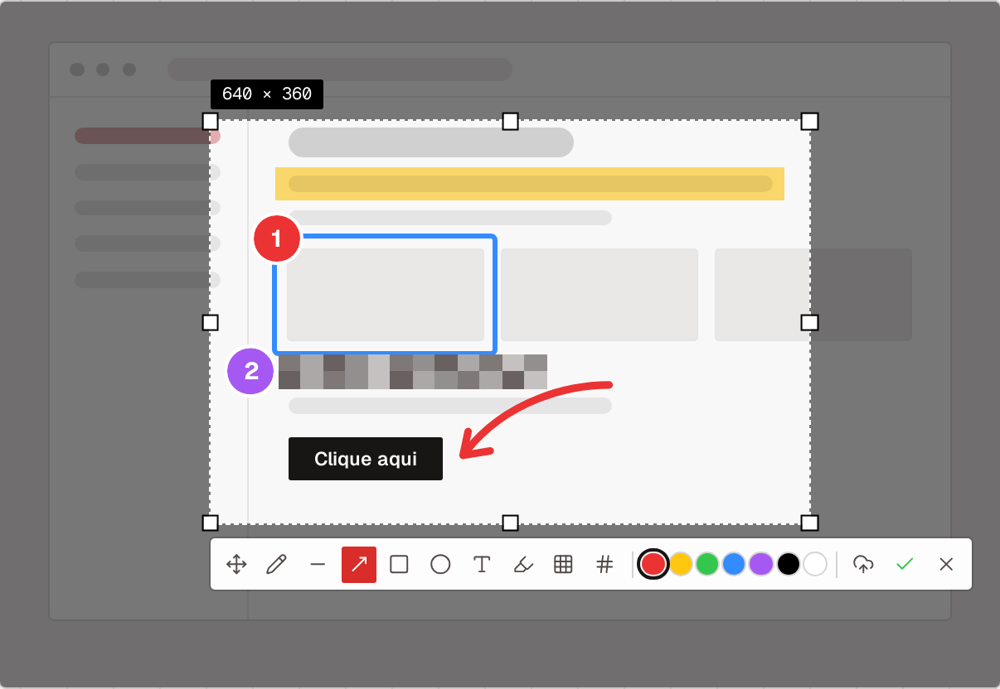

<div align="center">


# Recortei

**Aperte uma tecla, recorte a tela, anote e compartilhe.**<br>
Captura de área com anotações, inspirada no ShareX: leve, nativa e open source.

[](https://github.com/FabioHAraujo/Recortei/actions/workflows/ci.yml)
[](https://github.com/FabioHAraujo/Recortei/releases/latest)
[](LICENSE)
[](#download)

[**Download**](#download) · [Uso](#uso) · [Atalhos](#atalhos) · [Configuração](#configuração) · [Compilar](#compilar-a-partir-do-código)



</div>

## Por que o Recortei

- **Uma tecla e pronto.** **Insert** abre a captura de qualquer lugar, no Windows e no Linux.
- **Nove ferramentas de anotação**: caneta, linha, seta, retângulo, elipse, texto, marca-texto, pixelizar e numeração, cada uma com a sua tecla.
- **Copia e salva de uma vez.** Enter coloca a imagem na área de transferência e grava um PNG em `Imagens/Recortei`.
- **Link em um atalho.** Ctrl+U envia o recorte para o [vkdl.link](https://vkdl.link) e já copia o link.
- **Vários monitores**, com uma janela de seleção por tela e suporte a telas HiDPI.
- **Leve de verdade.** Um executável só, com menos de 10 MB, sem runtime para instalar e sem conta para criar.
- **Funciona offline.** Nada sai do seu computador a não ser que você peça o envio.
- **Lembra das suas escolhas**: ferramenta, cor e espessura ficam salvas para a próxima captura.

## Download

Baixe a versão mais recente para o seu sistema. Todos os arquivos estão na [página da última release](https://github.com/FabioHAraujo/Recortei/releases/latest), junto com o `SHA256SUMS` para conferir a integridade.

> Não há versão para macOS: o projeto foca em Windows e Linux.

| Sistema | Arquivo | O que é |
|---|---|---|
| **Windows 10/11** (x86_64) | [`Recortei-Setup-x86_64.exe`](https://github.com/FabioHAraujo/Recortei/releases/latest/download/Recortei-Setup-x86_64.exe) | Instalador (recomendado) |
| | [`recortei-windows-x86_64.zip`](https://github.com/FabioHAraujo/Recortei/releases/latest/download/recortei-windows-x86_64.zip) | Versão portátil, sem instalar |
| **Debian, Ubuntu, Mint…** | [`recortei-linux-amd64.deb`](https://github.com/FabioHAraujo/Recortei/releases/latest/download/recortei-linux-amd64.deb) | Pacote `.deb` |
| **Fedora, openSUSE…** | [`recortei-linux-x86_64.rpm`](https://github.com/FabioHAraujo/Recortei/releases/latest/download/recortei-linux-x86_64.rpm) | Pacote `.rpm` |
| **Arch, Manjaro, EndeavourOS…** | [`recortei-0.1.0-1-x86_64.pkg.tar.zst`](https://github.com/FabioHAraujo/Recortei/releases/download/v0.1.0/recortei-0.1.0-1-x86_64.pkg.tar.zst) | Pacote do `pacman` |
| **Outras distros** (x86_64) | [`recortei-linux-x86_64.tar.gz`](https://github.com/FabioHAraujo/Recortei/releases/latest/download/recortei-linux-x86_64.tar.gz) | Binário + `install.sh` para o seu usuário |

Para conferir um arquivo baixado no Linux, com ele e o `SHA256SUMS` na mesma pasta:

```bash
sha256sum -c SHA256SUMS --ignore-missing
```

No Windows: `Get-FileHash .\Recortei-Setup-x86_64.exe` e compare com a linha correspondente do `SHA256SUMS`.

## Instalação

### Windows

1. Rode o `Recortei-Setup-x86_64.exe`. Ele instala só para o seu usuário, sem pedir administrador, em `%LOCALAPPDATA%\Programs\Recortei`.
2. O instalador cria o atalho no Menu Iniciar, deixa marcada a opção de **iniciar com o Windows** e abre o Recortei ao terminar.
3. Aperte **Insert** para capturar.

> [!NOTE]
> O instalador ainda não é assinado digitalmente, então o **SmartScreen** pode mostrar o aviso "O Windows protegeu o computador". Clique em **Mais informações → Executar assim mesmo**. Se preferir, confira o arquivo pelo `SHA256SUMS` antes.

Para desinstalar, use **Configurações → Aplicativos → Aplicativos instalados → Recortei**. Instalação silenciosa: `Recortei-Setup-x86_64.exe /VERYSILENT /SUPPRESSMSGBOXES`.

A versão portátil (`.zip`) traz o `recortei.exe` com o README e a licença: extraia em qualquer pasta e rode. Ela não cria atalhos nem inicia com o Windows.

### Linux

Os pacotes instalam o binário em `/usr/bin/recortei`, o ícone e a entrada no menu de aplicativos.

```bash
# Debian, Ubuntu e derivados
sudo apt install ./recortei-linux-amd64.deb

# Fedora, openSUSE e derivados
sudo dnf install ./recortei-linux-x86_64.rpm      # ou: sudo zypper install ./recortei-linux-x86_64.rpm

# Arch Linux e derivados
sudo pacman -U ./recortei-0.1.0-1-x86_64.pkg.tar.zst
```

Depois, abra o **Recortei** pelo menu de aplicativos. Na primeira vez, ele faz sozinho a configuração do seu usuário: inicia junto com a sessão, registra a tecla **Insert** no GNOME e dá a permissão de captura do xdg-desktop-portal. Para refazer essa configuração quando quiser:

```bash
recortei --setup
```

**Outras distros (tar.gz):** extraia e rode o instalador, que copia tudo para `~/.local/bin` e roda o `recortei --setup`, sem pedir `sudo`:

```bash
tar xzf recortei-linux-x86_64.tar.gz
cd recortei-0.1.0-linux-x86_64
./install.sh
```

**Tecla de atalho:**

- **GNOME** (Wayland ou X11): o `--setup` cria um atalho personalizado **Insert** que chama `recortei --capture`. Dá para trocar a tecla em **Configurações → Teclado → Atalhos personalizados**.
- **KDE Plasma, Xfce, Cinnamon, Hyprland, Sway e outros**: crie no seu ambiente um atalho global para o comando `recortei --capture`.

**Ícone na bandeja:** no GNOME é preciso a extensão [AppIndicator](https://extensions.gnome.org/extension/615/appindicator-support/) (já vem ativa no Ubuntu). Sem ela, o Recortei funciona normalmente, só não aparece o ícone.

## Uso

1. Aperte **Insert** e arraste para selecionar a área. Funciona com vários monitores.
2. Anote com a barra de ferramentas que aparece logo abaixo da seleção.
3. **Enter**, **Ctrl+C**, **duplo clique** dentro da área ou **Insert** de novo: copia a imagem para a área de transferência e salva em `Imagens/Recortei`.
4. **Botão da nuvem** (ou **Ctrl+U**): envia o recorte para o [vkdl.link](https://vkdl.link), copia o link e também salva uma cópia em `Imagens/Recortei`.

Os arquivos são salvos como `Recorte_AAAA-MM-DD_HH-MM-SS.png` na pasta de imagens do sistema (por exemplo, `~/Imagens/Recortei` no Linux e `C:\Users\<você>\Pictures\Recortei` no Windows).

### Ferramentas

| Tecla | Ferramenta | Para quê |
|:---:|---|---|
| <kbd>V</kbd> | Mover | Ajusta e reposiciona a área selecionada |
| <kbd>P</kbd> | Caneta | Desenho livre |
| <kbd>L</kbd> | Linha | Retas (Shift trava em 45°) |
| <kbd>A</kbd> | Seta | Aponta o que importa |
| <kbd>R</kbd> | Retângulo | Destaca uma região (Shift faz um quadrado) |
| <kbd>E</kbd> | Elipse | Círculos e elipses (Shift faz um círculo) |
| <kbd>T</kbd> | Texto | Enter confirma, Shift+Enter quebra a linha |
| <kbd>H</kbd> | Marca-texto | Grifa sem cobrir o conteúdo |
| <kbd>B</kbd> | Pixelizar | Esconde senhas, e-mails e dados pessoais |
| <kbd>N</kbd> | Numeração | Marcadores 1, 2, 3… para um passo a passo |

### Atalhos

| Atalho | Ação |
|---|---|
| <kbd>Insert</kbd> | Abre a captura; com a captura aberta, confirma |
| <kbd>Enter</kbd> ou <kbd>Ctrl</kbd>+<kbd>C</kbd> | Copia a imagem e salva em `Imagens/Recortei` |
| <kbd>Ctrl</kbd>+<kbd>U</kbd> | Envia para o vkdl.link e copia o link |
| <kbd>1</kbd> a <kbd>7</kbd> | Troca a cor |
| Roda do mouse ou <kbd>+</kbd> / <kbd>−</kbd> | Espessura |
| <kbd>Shift</kbd> ao arrastar | Linhas em 45°, quadrados e círculos |
| <kbd>Ctrl</kbd>+<kbd>Z</kbd> | Desfazer |
| <kbd>Ctrl</kbd>+<kbd>Y</kbd> ou <kbd>Ctrl</kbd>+<kbd>Shift</kbd>+<kbd>Z</kbd> | Refazer |
| Setas (<kbd>Shift</kbd> = 10 px) | Move a área |
| <kbd>Ctrl</kbd>+setas | Redimensiona a área |
| Botão direito | Descarta a seleção e recomeça |
| <kbd>Esc</kbd> | Cancela a captura |

### Linha de comando

```text
recortei             inicia na bandeja
recortei --capture   captura agora (inicia o app se não estiver rodando)
recortei --quit      encerra a instância em execução
recortei --setup     Linux: configura autostart, tecla Insert no GNOME e permissão do portal
recortei --version   mostra a versão
recortei --help      mostra a ajuda
```

Só existe uma instância por vez: rodar `recortei --capture` com o app aberto apenas pede uma nova captura a ele. Para depurar eventos de teclado e mouse, rode com `RECORTEI_DEBUG=1`.

## Configuração

As preferências ficam em `config.json`:

| Sistema | Pasta |
|---|---|
| Linux | `~/.config/recortei/` |
| Windows | `%APPDATA%\recortei\` |

| Chave | Padrão | Descrição |
|---|---|---|
| `tool`, `color`, `width` | (a última usada) | Ferramenta, cor e espessura, salvas automaticamente |
| `upload_url` | `https://vkdl.link` | Origem do servidor de envio; o envio vai para `<upload_url>/v1/upload` |
| `upload_api_key` | (vazia) | Chave de API opcional, enviada como `Authorization: Bearer`. Sem ela, o envio é anônimo |
| `linux_setup_done` | (automático) | Linux: indica que a configuração da primeira execução já foi feita |

Exemplo:

```json
{
  "upload_url": "https://vkdl.link",
  "upload_api_key": "vk_sua-chave-aqui"
}
```

## Envio para o vkdl.link

O botão da nuvem (ou **Ctrl+U**) envia o recorte para o [vkdl.link](https://vkdl.link), um host de imagens de código aberto, e copia o link para a área de transferência. Uma cópia continua salva em `Imagens/Recortei`.

- **O link é público**: qualquer pessoa com ele vê a imagem. Use a ferramenta de pixelizar antes de enviar dados sensíveis.
- **Envios anônimos não têm prazo de retenção garantido**: quando o espaço acaba, os mais antigos são removidos primeiro.
- Dá para usar um servidor próprio compatível trocando o `upload_url`.

Cada envio acrescenta uma linha em `uploads.jsonl`, na mesma pasta do `config.json`, com `url`, `delete_url`, `delete_token` e `created_at`. Para apagar um arquivo enviado:

```bash
curl -X DELETE -H "X-Delete-Token: <delete_token>" <delete_url>
```

## Como funciona

O Recortei é escrito em Rust. A sobreposição de seleção (uma janela por monitor) é desenhada em software com `winit`, `softbuffer` e `tiny-skia`, então a aparência é a mesma em todos os sistemas. O texto usa a fonte DejaVu Sans embutida (licença em `assets/fonts`).

| | Windows | Linux |
|---|---|---|
| Captura | GDI (`BitBlt`), todos os monitores de uma vez | xdg-desktop-portal (Wayland e X11) |
| Tecla de atalho | **Insert** global com `RegisterHotKey` | atalho do ambiente → `recortei --capture` (no GNOME, criado pelo `--setup`) |
| Bandeja | `tray-icon` | StatusNotifierItem (`ksni`) |
| Notificações | notificações do Windows | D-Bus (`org.freedesktop.Notifications`) |
| Instância única | mutex + named pipe | socket Unix abstrato |

No Windows, o próprio Recortei registra a tecla Insert e captura a tela direto pelo GDI. No Linux, o Wayland não deixa um app registrar teclas globais, então quem chama a captura é o atalho do ambiente gráfico: `recortei --capture` encontra a instância que já está rodando e pede a captura a ela. A imagem da tela vem do xdg-desktop-portal, que funciona tanto no Wayland quanto no X11.

Onde está cada parte:

| Arquivo | O que faz |
|---|---|
| `src/main.rs` | Linha de comando e instância única |
| `src/app.rs` | Janelas, eventos e fluxo de captura |
| `src/overlay.rs` | Seleção, ferramentas, barra e atalhos |
| `src/draw.rs`, `src/text.rs` | Desenho das anotações e do texto |
| `src/output.rs` | Área de transferência, PNG e notificações |
| `src/upload.rs` | Envio para o vkdl.link |
| `src/config.rs` | `config.json` e pasta dos recortes |
| `src/platform/` | Partes específicas de cada sistema |
| `packaging/` | Ícones, instalador do Windows, pacotes Linux e PKGBUILD do Arch |

## Compilar a partir do código

Requer o [Rust](https://rustup.rs) estável. No Linux, também um compilador C para linkar (`build-essential` no Debian/Ubuntu, `base-devel` no Arch).

```bash
git clone https://github.com/FabioHAraujo/Recortei.git
cd Recortei
cargo build --release      # gera target/release/recortei (recortei.exe no Windows)
cargo test                 # testes
```

Para instalar o que você compilou no seu usuário:

```bash
./install.sh                                          # Linux
powershell -ExecutionPolicy Bypass -File install.ps1  # Windows (install.ps1 -Uninstall remove)
```

O CI compila e testa cada push no Linux e no Windows. Ao criar uma tag `v*`, o workflow de release gera todos os pacotes da tabela de [Download](#download) e publica a release com o `SHA256SUMS`.

## Contribuindo

Contribuições são muito bem-vindas, principalmente testes em ambientes Linux diferentes do GNOME (KDE Plasma, Xfce, Hyprland, Sway…) e em configurações de vários monitores.

- **Encontrou um problema?** [Abra uma issue](https://github.com/FabioHAraujo/Recortei/issues) com o sistema, a versão (`recortei --version`) e os passos para reproduzir. Para problemas de teclado ou mouse, a saída com `RECORTEI_DEBUG=1` ajuda muito.
- **Quer mandar código?** Faça um fork, crie um branch e abra um pull request. Antes, rode:

  ```bash
  cargo fmt
  cargo clippy --all-targets -- -D warnings
  cargo test
  ```

- Comentários e textos da interface são em português; nomes no código, em inglês.

## Licença

O Recortei é software livre, distribuído sob a [GNU General Public License v3.0 ou posterior](LICENSE) (GPL-3.0-or-later). Você pode usar, estudar, modificar e redistribuir; versões modificadas que forem distribuídas precisam manter a mesma licença e o código aberto.

A fonte DejaVu Sans embutida tem a sua própria licença, em [`assets/fonts/LICENSE-DejaVu.txt`](assets/fonts/LICENSE-DejaVu.txt).
